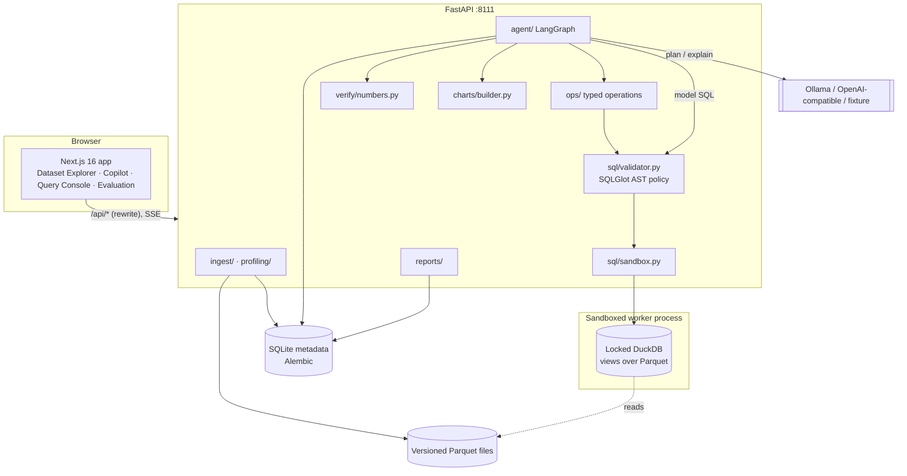

# Architecture

## Request lifecycle: “Which plan has the highest churn rate?”

1. `POST /api/analyses/stream` starts the LangGraph graph in a worker thread; graph nodes
   emit events that are forwarded as SSE.
2. **catalog**: a compact, profile-derived description of the datasets (types, roles,
   date ranges, top values).
3. **plan**: the LLM returns a JSON plan (constrained decoding via Ollama structured
   outputs). It may only *choose* typed operations or write a single SELECT.
4. **validate**: each step is validated by Pydantic (operation schemas) or the SQL AST
   policy. Errors are fed back to the planner for up to 3 attempts. Clarification ends the
   graph without computing anything.
5. **execute**: typed operations compile to SQL with quoted identifiers and SQLGlot
   literals, which is *re-validated* and executed in the sandboxed worker. SciPy /
   scikit-learn / statsmodels code runs on the returned frames. Every statement is logged.
6. **inspect**: empty results are noted; failures with retries left go back to **plan**.
7. **charts**: a typed `ChartConfig` is chosen from the result shape and built into a
   Plotly-validated figure server-side.
8. **explain**: the LLM writes prose using `{{fact_id}}` placeholders; the verifier
   resolves, checks and prunes it (see `ANALYTICAL_VERIFICATION.md`).
9. The analysis (plan, trace, steps, SQL, facts, charts, verification, dataset version ids,
   LLM usage, duration) is persisted and streamed as the final event.

## Module map (backend/src/insightforge)

| Module | Responsibility |
|---|---|
| `config.py` | Environment-driven settings (`INSIGHTFORGE_*`) |
| `db/` | SQLAlchemy models, sessions, Alembic migrations |
| `ingest/` | Format detection, parsing, normalisation, versioned Parquet storage |
| `profiling/` | DuckDB-computed column statistics and cleaning suggestions |
| `engine/duck.py` | Hardened DuckDB connection (views, allowed_paths, locked config) |
| `sql/` | AST validator, sandbox runner + worker, audited execution service |
| `ops/` | Typed operation models, safe SQL compilation context, 12 operations |
| `relationships.py` | Data-validated dataset join declarations |
| `llm/` | Provider protocol, Ollama / OpenAI-compatible / fixture providers |
| `agent/` | Catalog, prompts, plan contract, LangGraph graph, explainer, service |
| `verify/` | Numerical verification of explanations |
| `charts/` | ChartConfig → Plotly figure, validation, type suggestion |
| `reports/` | Markdown / HTML reports, CSV export |
| `evaluation/` | Benchmark with pandas-recomputed expected answers |
| `demo/` | Deterministic synthetic data generator and seeder |
| `api/` | FastAPI routers, dependencies, SSE middleware |

## Frontend (frontend/src)

* `app/` routes: `/` landing, `(app)/datasets`, `(app)/workspace`, `(app)/query`,
  `(app)/analyses`, `(app)/evaluation`. Client components fetch via TanStack Query.
* `components/workspace/useAnalysisRun.ts` drives the UI purely from SSE events.
* `components/charts/Plot.tsx` lazy-loads plotly.js and applies the theme.
* Business logic (planning, execution, verification, chart construction) lives in the
  backend; the frontend only renders and sends typed configurations.
