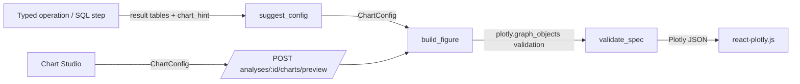

# Chart specification architecture

* **Input is a `ChartConfig`, never figure JSON.** `type` is one of line, area, bar,
  stacked_bar, grouped_bar, scatter, histogram, box, heatmap, treemap, funnel, forecast
  (no pie). Unknown fields are rejected (`extra="forbid"`).
* **Data comes only from stored result tables.** Distribution charts (box, scatter) use a
  seeded ≤5,000-row `raw` sample of the operation's *own filtered* rows, so a chart never
  shows data the analysis didn't use.
* **Selection rules** (`suggest_config`): time on x → line; group + time → stacked bar;
  more than 12 categories → horizontal bars, top 30; correlation of >2 columns or cohorts →
  heatmap; forecasts → actual + dashed forecast + labelled *approximate* band.
* **Validation:** the figure is built with `plotly.graph_objects` (unknown properties raise),
  re-validated, trace types are allow-listed, and the theme template is stripped so the
  frontend applies its own theme. No JavaScript is ever generated or accepted.
* **Chart Studio** re-renders server-side from stored tables (`/charts/preview`) and saves
  views (`PUT /charts`), rebuilding each saved figure rather than storing client JSON.
